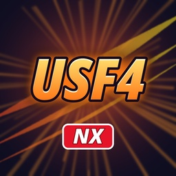

# usf4-nx

A static recompilation of **Ultra Street Fighter IV** (Xbox 360, title 434307FC) for PC and Nintendo Switch, made with
the ReXGlue SDK. It follows the method of
[sa2-nx](https://github.com/ChanseyIsTheBest/sa2-nx) (`docs/porting-a-360-game-prompt.md`).

**This repository holds no game data.** You need your own copy of the game. The code generated from `default.xex`,
the shaders extracted from the game and the binaries built from them are never committed; everyone builds them from
their own disc.

## Status

- **PC (Windows):** boots, menus and fights work with the native Vulkan renderer at 60 fps.
- **Switch (Atmosphère, homebrew NRO):** fights hold 60 fps at 540p with CPU 1785 MHz and GPU 998.4 MHz (overclocked,
  sys-clk). Work continues on lowering the GPU and memory clocks this needs.

Version history, measurements and every finding: [docs/usf4-notes.md](docs/usf4-notes.md).

## Building

See [docs/building.md](docs/building.md): Windows (PC), Linux, and the Switch build in the `devkitpro/devkita64`
Docker image.

## Icon

`app/icon.jpg` is an original icon made by [tools/make_icon.py](tools/make_icon.py). To use your own on your Switch
build, put a 256x256 JPEG at `app/icon_local.jpg` (git-ignored) and rebuild.

## License

GPL-3.0, see [LICENSE](LICENSE). Third-party components: [THIRD_PARTY_NOTICES.md](THIRD_PARTY_NOTICES.md). Ultra
Street Fighter IV is a trademark of Capcom; this project is not affiliated with or endorsed by Capcom.
